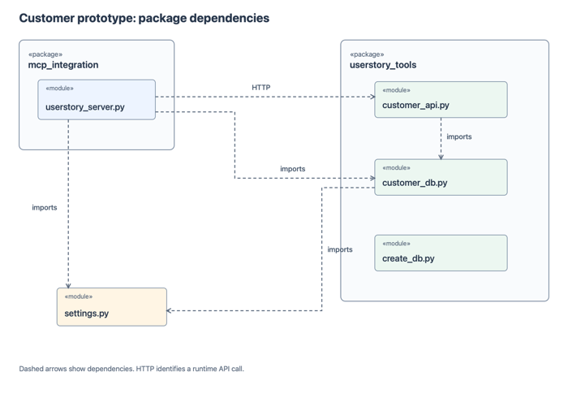

# User Story Tests

This project prototypes the automated creation of a set of artifacts from a user story:
- A user story ticket consistent with the documented OS+ API.
- An end-to-end test that verifies whether the current behaviour of the OS+ API endpoints is consistent with the documentation.

The project currently includes a local customer database, a customer API, and
an MCP server that exposes customer operations to Codex.

## Project structure

```text
userstory_tests/
├── docs/
│   ├── database.md              # Local database and customer operations
│   ├── mcp-server.md            # MCP server and API integration
│   └── testing.md               # Project tests
├── sql/
│   └── customer.sql             # CUSTOMER table definition
├── src/
│   ├── settings.py              # Shared project settings
│   ├── userstory_tools/
│   │   ├── create_db.py         # Creates the local database and table
│   │   ├── customer_db.py       # Customer database operations
│   │   └── customer_api.py      # FastAPI customer service
│   └── mcp_integration/
│       └── userstory_server.py  # Exposes customer operations as MCP tools
├── tests/
│   ├── test_create_db.py
│   ├── test_customer_db.py
│   ├── test_customer_api.py
│   ├── test_userstory_client.py
│   └── test_userstory_server.py
├── pyproject.toml
└── README.md
```

## Package diagram



## MCP server

The MCP server exposes customer operations to Codex through direct database
and API tools. For the architecture and setup instructions, see
[MCP server](docs/mcp-server.md).

## Documentation

- [Local database](docs/database.md): database setup and customer operations.
- [MCP server](docs/mcp-server.md): customer tools and connection to Codex.
- [Testing](docs/testing.md): automated and manual tests.
