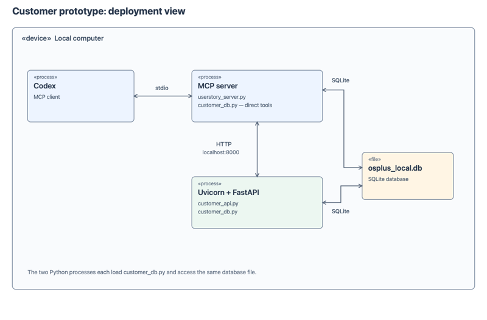

# MCP server

The MCP server gives Codex access to customer operations. It provides two
routes to the local database: direct database tools and tools that call the
customer API over HTTP.

```text
Codex, acting as the MCP client
    │ MCP over stdio                                        osplus_local.db
    │                                                       ↑
userstory_server.py                                         │
    ├── Database tools ────────────────────────────────────→customer_db.py
    │   Prepare or inspect database state                   │
    └── API tools → HTTP → Uvicorn → FastAPI ──────────────→customer_api.py
        Test the route a future frontend could use
```

The server is defined in `src/mcp_integration/userstory_server.py`. Codex
acts as the MCP client: it discovers the available tools and can request
their execution. The server starts when Codex launches it using the configured
command.

The direct tools call `customer_db.py`. The API tools send HTTP requests to
the FastAPI application in `customer_api.py`; Uvicorn runs that application,
which calls the same database functions. The API must be running when the API
tools are called. The API address is defined in `src/settings.py`.

## Why two sets of tools?

The direct database tools provide a simple first layer: Codex can work with
the customer database without going through the API. They also make it easier
to prepare the database state needed for testing.

The API tools add another layer. They let us test the route a future frontend
could use, while working with the same database.

## Deployment diagram



[View the larger diagram](images/userstory-deployment-diagram.png).

## Connect the server to Codex

Add an entry for the server to `~/.codex/config.toml`, preserving any existing
contents. Replace `/path/to/userstory_tests` with the absolute path to your
project:

```toml
[mcp_servers.userstory]
command = "/path/to/userstory_tests/.venv/bin/python"
args = ["/path/to/userstory_tests/src/mcp_integration/userstory_server.py"]
cwd = "/path/to/userstory_tests"
```

The project environment and local database must already exist. See
[Local database](database.md) for database setup.

After saving the configuration, restart Codex and start a new local
conversation. Use `/mcp` to check that the server is connected. You can then
ask Codex to use a customer tool from the `userstory` MCP server.

## Tests

For instructions on running the API and testing the server, see
[Testing](testing.md).

